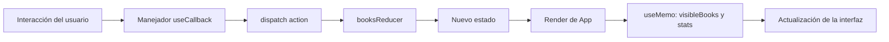
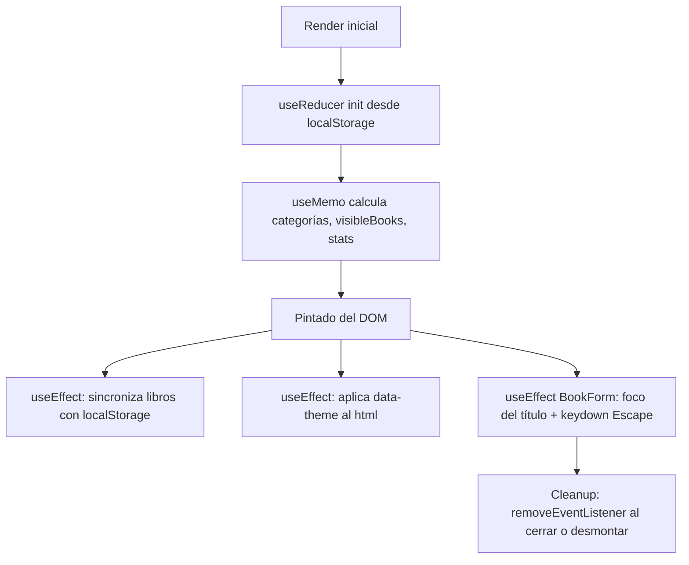

# Biblioteca Virtual PRAXIS

Aplicación web SPA desarrollada con React + Vite para organizar el catálogo de libros de un colegio de Huancayo. El proyecto cumple con la guía práctica **Semana 07 – 2.ª parte** de la asignatura *Desarrollo de Aplicaciones Web (IS093A)* de la UNCP.

> **Nota:** los libros incluidos son datos demostrativos. No representan el inventario real del colegio PRAXIS.

---

## 1. Objetivo

Construir una aplicación pequeña, funcional y visualmente ordenada que demuestre el uso real y justificado de **siete Hooks de React y un Hook personalizado**, aplicados a un catálogo escolar de libros.

---

## 2. Tecnologías utilizadas

- React 18 con componentes funcionales.
- JavaScript + JSX.
- Vite como bundler.
- CSS puro (sin frameworks).
- `lucide-react` para iconos.
- `localStorage` para persistencia.
- ESLint con `eslint-plugin-react-hooks`.

---

## 3. Requisitos

- Node.js 18 o superior.
- npm 9 o superior.

---

## 4. Instalación y ejecución

```bash
npm install
npm run dev
```

Abrir `http://localhost:5173`.

Para verificar el lint:

```bash
npm run lint
```

Para generar la build de producción:

```bash
npm run build
npm run preview
```

---

## 5. Estructura de carpetas

```text
biblioteca-praxis/
├── index.html
├── package.json
├── vite.config.js
├── .eslintrc.cjs
├── README.md
└── src/
    ├── main.jsx
    ├── App.jsx
    ├── index.css
    ├── contexts/
    │   ├── ThemeContext.jsx
    │   └── theme-context.js
    ├── hooks/
    │   ├── useBooksReducer.js
    │   ├── useLocalStorage.js
    │   └── useTheme.js
    └── components/
        ├── Header.jsx
        ├── Sidebar.jsx
        ├── StatsCards.jsx
        ├── BookCard.jsx
        ├── BookForm.jsx
        ├── BookFilters.jsx
        └── ThemeToggle.jsx
```

---

## 6. Componentes principales

| Componente | Responsabilidad |
|---|---|
| `Header` | Marca PRAXIS, búsqueda, botón de tema y botón "Agregar libro". |
| `Sidebar` | Navegación de filtros rápidos: Inicio, Todos, Disponibles, Prestados. |
| `StatsCards` | Cuatro tarjetas derivadas del catálogo: total, disponibles, prestados, categorías. |
| `BookFilters` | Filtros por categoría, disponibilidad y orden. |
| `BookCard` | Tarjeta de cada libro, con acciones de estado, edición y eliminación. `React.memo`. |
| `BookForm` | Modal para agregar o editar un libro. Usa `useRef` para el foco del título. |
| `ThemeToggle` | Botón que alterna el tema consumiendo `useTheme`. |

---

## 7. Explicación técnica de cada Hook

### 7.1 `useReducer` — `src/hooks/useBooksReducer.js`

Administra el estado complejo del catálogo:

```js
{
  books: [],
  filters: { category: 'todas', status: 'todos' },
  sort:    { by: 'titulo', direction: 'asc' }
}
```

Acciones: `INIT_BOOKS`, `ADD_BOOK`, `REMOVE_BOOK`, `UPDATE_BOOK`, `TOGGLE_AVAILABILITY`, `SET_CATEGORY_FILTER`, `SET_STATUS_FILTER`, `SET_SORT`, `RESET_FILTERS`.

El reducer es una función pura: recibe `(state, action)` y devuelve un **nuevo** objeto sin mutar el anterior (uso de spread para libros, filtros y orden).

### 7.2 `useState` — `App.jsx` y `BookForm.jsx`

- `search` (texto de búsqueda).
- `activeNav` (opción activa del sidebar).
- `formOpen` y `editingBook` (control del modal).
- `form` y `errors` en `BookForm`.

No se duplica el estado del catálogo: la lista, filtros y orden viven en el reducer.

### 7.3 `useContext` — `src/contexts/ThemeContext.jsx` + `theme-context.js`

`ThemeProvider` publica `{ theme, toggleTheme }` a través de `ThemeContext`. Los consumidores acceden con el hook `useTheme` sin pasar props por toda la jerarquía.

El objeto del contexto vive en un archivo aparte (`theme-context.js`) para que ESLint (`react-refresh/only-export-components`) no marque el `.jsx` del Provider.

### 7.4 `useEffect`

1. **Persistencia de libros** (`App.jsx`): cada vez que cambia `state.books`, se serializa el arreglo a `localStorage`. Dependencia: `[state.books]`.
2. **Sincronización del tema** (`ThemeContext.jsx`): aplica `data-theme` al `<html>` cuando cambia `theme`.
3. **Evento de teclado con limpieza** (`BookForm.jsx`): registra `keydown` para cerrar el modal con `Escape` y **retorna una función de limpieza** que retira el listener.

### 7.5 `useMemo`

En `App.jsx`:

- `categories`: conjunto único de categorías ordenadas alfabéticamente.
- `visibleBooks`: aplica búsqueda + filtros + ordenamiento **sin mutar** `state.books` (usa `[...result].sort()`).
- `stats`: total, disponibles, prestados y número de categorías.

Dependencias explícitas en cada caso: `[state.books]`, `[state.books, state.filters, state.sort, search]`, `[state.books, categories]`.

### 7.6 `useCallback`

Memoriza los handlers que se pasan a componentes hijos (que a su vez están envueltos en `React.memo` o que dependen de props estables):

- `handleAddBook`, `handleEditBook`, `handleCloseForm`, `handleSubmitBook`.
- `handleRemoveBook`, `handleToggleStatus`.
- `handleNavChange`, `handleCategoryChange`, `handleStatusChange`, `handleSortByChange`, `handleDirectionChange`.

### 7.7 `useRef`

En `BookForm.jsx`:

```js
const titleRef = useRef(null)
useEffect(() => { titleRef.current?.focus() }, [])
```

Cumple el requisito de **enfocar automáticamente el campo título** al abrir el formulario, tanto desde "Agregar libro" como desde "Editar".

### 7.8 Hook personalizado: `useLocalStorage`

`src/hooks/useLocalStorage.js` encapsula lectura y escritura seguras de `localStorage`:

- Recibe `key` y `valor inicial`.
- Parsea con `JSON.parse` dentro de `try/catch`.
- Serializa con `JSON.stringify`.
- Expone `[valor, setValor]` con la misma firma que `useState`.
- Se reutiliza en `ThemeContext` para persistir el tema (`'praxis-theme'`).

---

## 8. ¿Por qué `useReducer` y no solo `useState`?

El catálogo tiene **cuatro dimensiones de estado que cambian juntas**: libros, filtro de categoría, filtro de estado y orden (criterio + dirección). Con `useState` esto implicaría:

- Múltiples `setState` que pueden quedar desincronizados.
- Lógica de actualización dispersa en cada handler.
- Dificultad para razonar y testear las transiciones.

Con `useReducer`:

- Todas las transiciones quedan declaradas en un único lugar (`booksReducer`).
- Cada acción tiene un nombre explícito (`ADD_BOOK`, `TOGGLE_AVAILABILITY`, …).
- El reducer es una función pura y testeable de forma aislada.
- La UI solo despacha acciones; no conoce la forma interna del estado.

---

## 9. Diagrama de flujo del estado



---

## 10. Diagrama del ciclo de renderizado y efectos



---

## 11. Persistencia con `localStorage`

- **Libros:** clave `'praxis-books'`. Se cargan en la **función inicializadora** del reducer (solo una vez) y se guardan en el `useEffect` que depende de `state.books`.
- **Tema:** clave `'praxis-theme'`, gestionado por `useLocalStorage` dentro de `ThemeContext`.
- Si no hay nada guardado o el JSON es inválido, `loadBooksFromStorage` devuelve `null` y se usan los `SAMPLE_BOOKS`.

---

## 12. Dependencias y limpieza de `useEffect`

| Efecto | Dependencias | Limpieza |
|---|---|---|
| Persistencia de libros | `[state.books]` | No aplica. |
| Aplicar `data-theme` | `[theme]` | No aplica. |
| `keydown` Escape en `BookForm` | `[onClose]` | `removeEventListener('keydown', handleKey)` |

Verificación manual de limpieza:

1. Abrir el modal → abrir DevTools → pestaña *Elements* sobre `<html>`.
2. Cerrar con Escape → el listener desaparece del componente.
3. Desmontar el modal (cambiar de vista o recargar) → la consola no muestra warnings.

---

## 13. Validación de rendimiento con React DevTools Profiler

Pasos para el estudiante:

1. Instalar [React Developer Tools](https://react.dev/learn/react-developer-tools).
2. Abrir la app en modo dev (`npm run dev`).
3. Pestaña **Profiler** → botón ⏺ → realizar una acción (ej. cambiar la disponibilidad de un libro) → ⏹.
4. Revisar el *ranked chart*:
   - `BookCard` con `React.memo` solo debe re-renderizarse para el libro afectado.
   - `App` sí se re-renderiza porque cambia el estado global; es esperado.
   - `Header`, `Sidebar`, `ThemeToggle`, `BookFilters` no reciben props que cambien al alternar disponibilidad, por lo que pueden evitar renders si se memoizan (opcional).
5. Anotar resultados reales aquí:

```text
[completar] Captura del Profiler tras cambiar la disponibilidad de un libro.
[completar] Componentes que se re-renderizaron y por qué.
[completar] Componentes que se evitaron con React.memo.
```

> No se declaran mejoras porcentuales si no se han medido.

---

## 14. Pruebas funcionales

Marcar cada una tras ejecutarla:

- [ ] `npm run dev` arranca sin errores en consola.
- [ ] Se ven los 6 libros de ejemplo en la primera carga.
- [ ] Agregar un libro: abre el modal, el foco cae en "Título".
- [ ] Guardar: aparece en la grilla.
- [ ] Validación: título, autor y categoría obligatorios muestran error.
- [ ] Escape cierra el modal sin guardar.
- [ ] Editar un libro: se abre el modal con los datos cargados.
- [ ] Eliminar un libro: desaparece de la lista.
- [ ] Marcar como prestado y devolver: el badge cambia.
- [ ] Buscar por título y por autor.
- [ ] Combinar filtro de categoría + disponibilidad + orden ascendente/descendente.
- [ ] Cambiar tema y comprobar que se aplica a toda la interfaz.
- [ ] Recargar: libros y tema se conservan.
- [ ] Vista móvil (≤ 720 px): sidebar apilado y grid a una columna.
- [ ] `npm run lint` sin errores ni warnings.

---

## 15. Evidencias sugeridas

Adjuntar capturas reales (no ilustrativas) de:

1. Aplicación funcionando en escritorio.
2. Registro de un libro.
3. Búsqueda + filtros combinados.
4. Tema claro y oscuro.
5. Persistencia tras recargar la página.
6. Salida de `npm run lint`.
7. React DevTools Profiler.
8. Consola limpia al abrir/cerrar el modal (limpieza de `useEffect`).

```text
[completar] Captura 1: …
[completar] Captura 2: …
```

---

## 16. Sobre la entrega

- Este proyecto no ha sido subido a GitHub ni a ADESA por parte del asistente.
- El estudiante debe:
  1. Inicializar el repositorio y subirlo a GitHub.
  2. Comprimir el proyecto en ZIP.
  3. Comprimir el proyecto en RAR para ADESA.